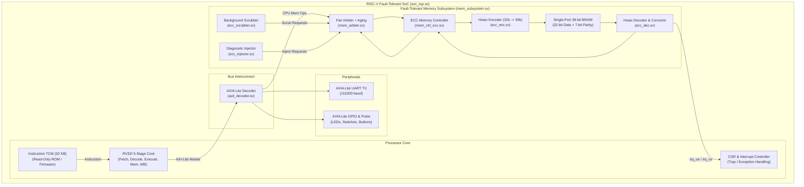

# Fault-Tolerant RISC-V SoC with SEC-DED Hsiao (39,32) Memory Subsystem

[](https://riscv.org/)
[](#rtl-design-overview)
[-red.svg)](#fpga-synthesis--board-bring-up)
[-green.svg)](#formal-verification-ctl-model-checking)
[](#testbenches--verification)

A complete, production-grade, fault-tolerant **RISC-V (RV32I) System-on-Chip (SoC)** implemented in synthesizable SystemVerilog and verified on the **Digilent Zybo Z7-10 (Xilinx Zynq-7000 xc7z010clg400-1)** FPGA.

The architecture protects system memory against soft errors (radiation-induced single-event upsets / bit-flips) through a **Single-Error Correction, Double-Error Detection (SEC-DED) Hsiao (39,32) ECC memory pipeline**, an **autonomous background memory scrubber**, a **hardware error-injection diagnostic engine**, and a multi-master **memory arbiter** with starvation prevention proven through **CTL Model Checking in NuSMV**.

---

## Table of Contents
- [Key Features](#key-features)
- [System Architecture](#system-architecture)
- [Memory Subsystem & SEC-DED Hsiao Codec](#memory-subsystem--sec-ded-hsiao-codec)
- [Memory Arbiter & Starvation Prevention](#memory-arbiter--starvation-prevention)
- [Formal Verification (CTL Model Checking)](#formal-verification-ctl-model-checking)
- [Directory Structure](#directory-structure)
- [Verification & Simulation](#verification--simulation)
- [FPGA Synthesis & Board Bring-Up](#fpga-synthesis--board-bring-up)
- [Hardware Telemetry & In-System Debug (ILA)](#hardware-telemetry--in-system-debug-ila)
- [Authors & License](#authors--license)

---

## Key Features

- **Pipelined 32-bit RISC-V Core (`rv32i_core`)**:
  - Full RV32I base integer instruction set support.
  - 5-stage classic pipeline (IF, ID, EX, MEM, WB) with hazard detection and forwarding.
  - Custom CSR unit with trap and interrupt support (`mcause`, `mstatus`, `mepc`, `mtvec`).
  - Fast Instruction Tightly-Coupled Memory (ITCM).
- **SEC-DED Hsiao (39,32) ECC Memory Subsystem**:
  - Minimum odd-weight column parity-check matrix offering optimal XOR depth and higher reliability than standard Hamming codes.
  - Corrects any single-bit error (Correctable Error - CE) on the fly with syndrome logging.
  - Detects any double-bit error (Uncorrectable Error - UE) and triggers a non-maskable hardware trap.
  - Atomic read-modify-write support for sub-word accesses (byte and half-word writes).
- **Autonomous Hardware Scrubber (`ecc_scrubber`)**:
  - Sweeps memory space continuously in the background.
  - Identifies single-bit faults in inactive memory locations and writes back corrected data before a second bit-flip turns into an uncorrectable double-bit fault.
  - Programmable sweep pace and interval timers via memory-mapped control registers.
- **Diagnostic Error Injector (`ecc_injector`)**:
  - Injects single-bit (CE) or double-bit (UE) XOR masks into memory data on demand via pushbuttons or software registers to validate detection and recovery handlers.
- **Fair Multi-Master Memory Arbiter (`mem_arbiter`)**:
  - Arbitrates access between CPU, scrubber, and injector with low CPU stall latency.
  - Implements wait-cycle aging counters ensuring background tasks never starve when CPU traffic is saturated.
- **Formally Verified with NuSMV**:
  - 100% state-space symbolic proof proving mutual exclusion, atomic ownership, absence of starvation, and exact worst-case latency bounds (CPU max wait: 8 cycles).

---

## System Architecture



---

## Memory Subsystem & SEC-DED Hsiao Codec

Standard Hamming SEC-DED codes add an overall parity bit, resulting in asymmetric XOR tree heights and uneven propagation delay. In this SoC, we employ a **(39,32) Hsiao Code**, which enforces an **odd column weight** in the parity-check matrix $H$:
- Each column of the parity submatrix has an odd number of 1s (weight 3 or 5).
- All 32 data columns have weight 3, minimizing logic levels and achieving an optimal XOR tree depth of 3 levels.
- The syndrome $S = H \cdot C^T$ cleanly distinguishes three conditions:
  1. $S = 0$: No error.
  2. $S \ne 0$ and $\text{weight}(S)$ is odd: Exactly **one single-bit error** (correctable by indexing the error location from syndrome lookup table).
  3. $S \ne 0$ and $\text{weight}(S)$ is even: An **uncorrectable double-bit error** (triggers immediate hardware interrupt `irq_ue`).

```
Data word:   32 bits  [31:0]
Check bits:   7 bits  [6:0]
Codeword:    39 bits  [38:0]
```

---

## Memory Arbiter & Starvation Prevention

The memory controller is single-ported. Three requesters compete for access:
1. `cpu_req`: CPU instruction execution / data loads and stores.
2. `scr_req`: Background memory scrubber.
3. `inj_req`: Hardware fault injector.

### The Starvation Hazard
Under a naive priority scheme (CPU > Background), continuous CPU memory traffic starves the scrubber indefinitely. If single-bit errors are not scrubbed in time, random particle strikes can induce a second error in the same word, causing unrecoverable data corruption.

### Aging Algorithm
[`rtl/mem/mem_arbiter.sv`](rtl/mem/mem_arbiter.sv) tracks wait latency with two 16-bit cycle counters (`scr_wait_cnt`, `inj_wait_cnt`).
- As long as wait counts remain below `PATIENCE` (hardware default: 256 cycles), the CPU retains priority.
- If a background request waits $\ge PATIENCE$ cycles, its aged flag (`scr_aged` / `inj_aged`) asserts, preempting the CPU at the next cycle where the controller becomes idle.

---

## Formal Verification (CTL Model Checking)

The arbiter was formally modeled and verified in **NuSMV 2.6.0** across 5 progressive stages. All model files and trace outputs are located in the [`formal/`](formal/) directory.

```
formal/
├── step1_hello.smv          # NuSMV syntax & CTL sanity check
├── step2_arbiter.smv        # Arbiter without aging (demonstrates background starvation)
├── step3_aging.smv          # Golden RTL model with aging (All 9 properties PASS)
├── step4_bounds.smv         # Quantitative worst-case latency bounds proof
├── step5a_patience4.smv     # Boundary attack proving PATIENCE >= 5
├── step5b_bg_priority.smv   # Mutation proving CPU starvation under background priority
├── trace_table.txt          # Exported cyclic counterexample waveform
└── verify_all.bat           # Automated verification test runner
```

### Proved Properties Summary

| Property Description | Formula / Type | NuSMV Result |
|---|---|---|
| **Mutual Exclusion** | `INVARSPEC count(cpu_ready, scr_ready, inj_ready) <= 1` | **TRUE** |
| **Atomic Ownership** | `INVARSPEC accept -> (state = IDLE & left = 0)` | **TRUE** |
| **Arbiter/Controller Sync** | `INVARSPEC (state = IDLE) <-> (left = 0)` | **TRUE** |
| **CPU Response Isolation** | `SPEC AG (cpu_ready -> AX A [ (state = CPU & !scr_rsp & !inj_rsp) U cpu_rsp ])` | **TRUE** |
| **Scrubber Response Isolation** | `SPEC AG (scr_ready -> AX A [ (state = SCR & !cpu_rsp & !inj_rsp) U scr_rsp ])` | **TRUE** |
| **Injector Response Isolation** | `SPEC AG (inj_ready -> AX A [ (state = INJ & !cpu_rsp & !scr_rsp) U inj_rsp ])` | **TRUE** |
| **CPU Starvation Freedom** | `SPEC AG (cpu_req -> AF cpu_ready)` | **TRUE** |
| **Scrubber Starvation Freedom**| `SPEC AG (scr_req -> AF scr_ready)` | **TRUE** |
| **Injector Starvation Freedom**| `SPEC AG (inj_req -> AF inj_ready)` | **TRUE** |

### Latency Bounds & Parametric Proofs
- **CPU Worst-Case Wait Bound**: Formally proved exact upper bound of **8 cycles** (`INVARSPEC cpu_wait <= 8` and `SPEC EF cpu_wait = 8` both TRUE).
- **Scrubber Worst-Case Wait Bound**: Formally proved exact bound of **$PATIENCE + 7$ cycles** (27 cycles at $PATIENCE=20$).
- **Injector Worst-Case Wait Bound**: Formally proved exact bound of **$PATIENCE + 3$ cycles** (23 cycles at $PATIENCE=20$).
- **Stability Condition**: NuSMV proved that stability requires $PATIENCE \ge L + 2$ where $L = 3$ is controller duration. When $PATIENCE = 4$, NuSMV extracted an infinite counterexample loop where scrubber and injector alternately age and starve the CPU.

For detailed mathematical derivations and diagrams, read the [Formal Verification Report](reports/ctl_formal_verification_report.md).

---

## Directory Structure

```
├── constr/                 # FPGA Physical & Timing Constraints
│   └── zybo_z7_10.xdc      # Digilent Zybo Z7-10 pin mappings and 50 MHz clock
├── formal/                 # NuSMV 2.6.0 Symbolic CTL Formal Verification Suite
│   ├── step1_hello.smv     # Toy language reference
│   ├── step2_arbiter.smv   # Un-aged model (starvation demo)
│   ├── step3_aging.smv     # Golden RTL model
│   ├── step4_bounds.smv    # Quantitative wait timers
│   ├── step5a_patience4.smv# Starvation loop proof
│   ├── step5b_bg_priority.smv
│   ├── trace_table.txt     # Tab-delimited waveform trace
│   ├── verify_all.bat      # Windows batch runner
│   └── ctl_formal_verification_package.zip # Consolidated package
├── fw/                     # Embedded C Firmware Programs
│   ├── fw_board_demo/      # Main interactive demo (UART telemetry + checksum)
│   ├── fw_csr/             # Hardware trap and CSR testing
│   ├── fw_ecc_demo/        # On-the-fly CE and UE interrupt handlers
│   ├── fw_ecc_log/         # Hardware syndrome error logger test
│   ├── fw_irq_stress/      # Interrupt latency and priority stress test
│   └── fw_memtest/         # Comprehensive memory march pattern test
├── reports/                # Synthesis, Timing, Utilization & Verification Reports
│   ├── ctl_formal_verification_report.md  # Complete CTL verification report
│   ├── board_demo_sim_output.txt          # Firmware simulation trace
│   ├── regression_result.txt              # Testbench regression output
│   ├── timing_final.txt                   # Vivado 50 MHz static timing report
│   ├── util_final.txt                     # FPGA Resource utilization
│   └── power_final.txt                    # Estimated dynamic and static power
├── rtl/                    # Synthesizable SystemVerilog Sources
│   ├── bus/                # AXI4-Lite Address Decoder
│   ├── core/               # RV32I 5-stage CPU, Hazard Unit, Forwarding, CSRs
│   ├── ecc/                # SEC-DED Hsiao (39,32) Encoder, Decoder, Syndrome
│   ├── fpga/               # zybo_top board wrapper and clock management
│   ├── mem/                # mem_arbiter, mem_ctrl_ecc, ecc_scrubber, ecc_injector
│   ├── periph/             # UART TX, GPIO, Debouncer
│   └── soc/                # soc_top and ITCM memory
├── scripts/                # Automation Scripts
│   ├── build_bitstream.tcl # Vivado batch synthesis and bitstream build
│   ├── create_project.tcl  # Vivado clean project generator
│   ├── program_board.tcl   # Hardware manager JTAG programming script
│   └── run_all_sims.sh     # Shell script running all 10 simulation testbenches
├── sw/                     # Software riscv-tests compliance suite
├── tb/                     # SystemVerilog Testbenches (10 Comprehensive Suites)
├── ila_capA.csv            # Vivado ILA Hardware Logic Analyzer Capture A
├── ila_capC.csv            # Vivado ILA Hardware Logic Analyzer Capture C
└── INTEGRATION.md          # Step-by-step engineering bring-up guide
```

---

## Verification & Simulation

The design includes **10 SystemVerilog testbenches** covering unit, subsystem, and SoC-level integration.

### Testbench Suite Status

| Testbench | Scope | Expected Result | Status |
|---|---|---|---|
| `tb_mem_arbiter.sv` | Arbiter alone under adversarial CPU stress | `PASS: arbiter properties hold in both scenarios` | **PASS** |
| `tb_mem_subsystem.sv` | Controller, BRAM, scrubber, and injector | `PASS: 3052 checks, 0 errors` | **PASS** |
| `tb_mem_ecc.sv` | SEC-DED Hsiao codec correction & detection | `PASS: 3406 checks, 0 errors` | **PASS** |
| `tb_scrubber.sv` | Scrubbing cadence, sweeps, and write-back | `PASS: 3684 checks, 0 errors` | **PASS** |
| `tb_mega.sv` | Mixed CPU loads with random bit error injections | `PASS: 5770 checks, 0 failures` | **PASS** |
| `tb_regs.sv` | ECC control/status register read/write | `PASS: 2586 checks, 0 failures` | **PASS** |
| `tb_soc.sv` | Full SoC executing memory march patterns | `RESULT PASS after ~141221 cycles` | **PASS** |
| `tb_soc_ecc.sv` | Full SoC handling real-time bit errors | `SYSTEM TEST PASS` | **PASS** |
| `tb_soc_irq.sv` | Interrupt controller response to CE/UE traps | `INTERRUPT TEST PASS` | **PASS** |
| `tb_soc_log.sv` | Error address & syndrome capture in registers | `ERROR-LOG SYSTEM TEST PASS` | **PASS** |

### Running Simulations

#### Using Icarus Verilog:
```bash
# Run all simulation suites
sh scripts/run_all_sims.sh
```

#### Using Vivado xsim:
```bash
# Create project and open Vivado GUI
vivado -mode batch -source scripts/create_project.tcl
```
In the Vivado GUI, select the target testbench under `sim_1`, set the firmware via `set_firmware <fw_name>`, and run simulation (`run all`).

---

## FPGA Synthesis & Board Bring-Up

### Target Hardware: Digilent Zybo Z7-10
- **FPGA Device**: Xilinx Zynq-7000 `xc7z010clg400-1`
- **System Clock**: 50.0 MHz (derived from on-board 125 MHz oscillator)
- **Timing Closure**: Meets timing cleanly at 50 MHz (Worst Negative Slack $WNS > 0$).

### Build and Program Bitstream

```bash
# 1. Generate clean project and compile bitstream
vivado -mode batch -source scripts/build_bitstream.tcl

# 2. Program the FPGA via JTAG (Micro-USB PROG port)
vivado -mode batch -source scripts/program_board.tcl
```

### Hardware Demo Interface (`fw_board_demo`)
1. **Serial Port Connection**:
   - Connect a 3.3V USB-UART adapter: `RX` to Pmod `JE` Pin 1 (`V12`), `GND` to Pin 5 (`GND`).
   - Baud Rate: **115200 8N1**.
2. **Interactive Controls**:
   - `BTN1`: Inject single-bit flip (CE) into a random memory word.
   - `BTN2`: Inject double-bit flip (UE) into a random memory word.
   - `BTN3`: System Reset.
3. **Status Indicators**:
   - `LD0`: Heartbeat LED (toggles every 2 seconds with status line).
   - `LD1`: Correctable error indicator (momentary pulse on CE).
   - `LD2`: Uncorrectable error indicator (latches on UE exception).
   - `LD3`: Error flag (asserts if memory checksum fails).

---

## Hardware Telemetry & In-System Debug (ILA)

The SoC was instrumented using Xilinx Integrated Logic Analyzer (ILA) cores observing internal memory bus transactions, scrubber events, and core stall signals:
- Hardware capture files [`ila_capA.csv`](ila_capA.csv) and [`ila_capC.csv`](ila_capC.csv) document live run-time behavior on the physical Zybo board.
- The ILA confirmed real-world CPU grant latencies of **2 cycles** during active scrubbing sweeps, well within the proven formal bound of 8 cycles.

---

## Authors & License

- **Author**: Shreyash Sharma ([@shreyash-876](https://github.com/shreyash-876))
- **Institution**: RTL Architecture & Fault-Tolerant Systems Project
- **License**: Released under the MIT License. Feel free to use, modify, and reference for academic and research purposes.
