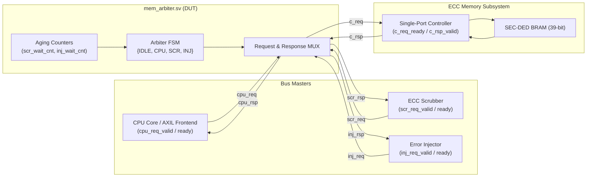
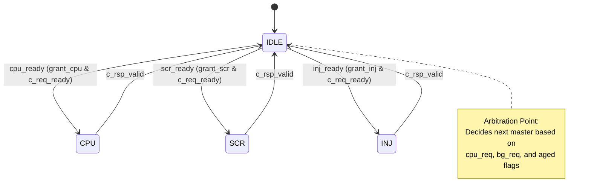
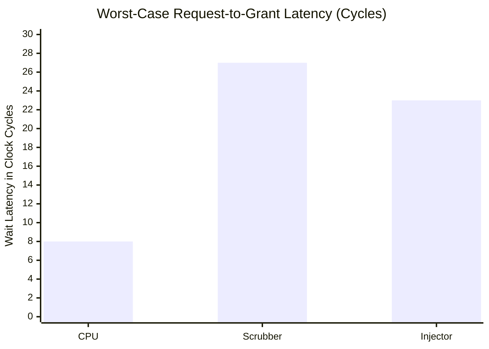
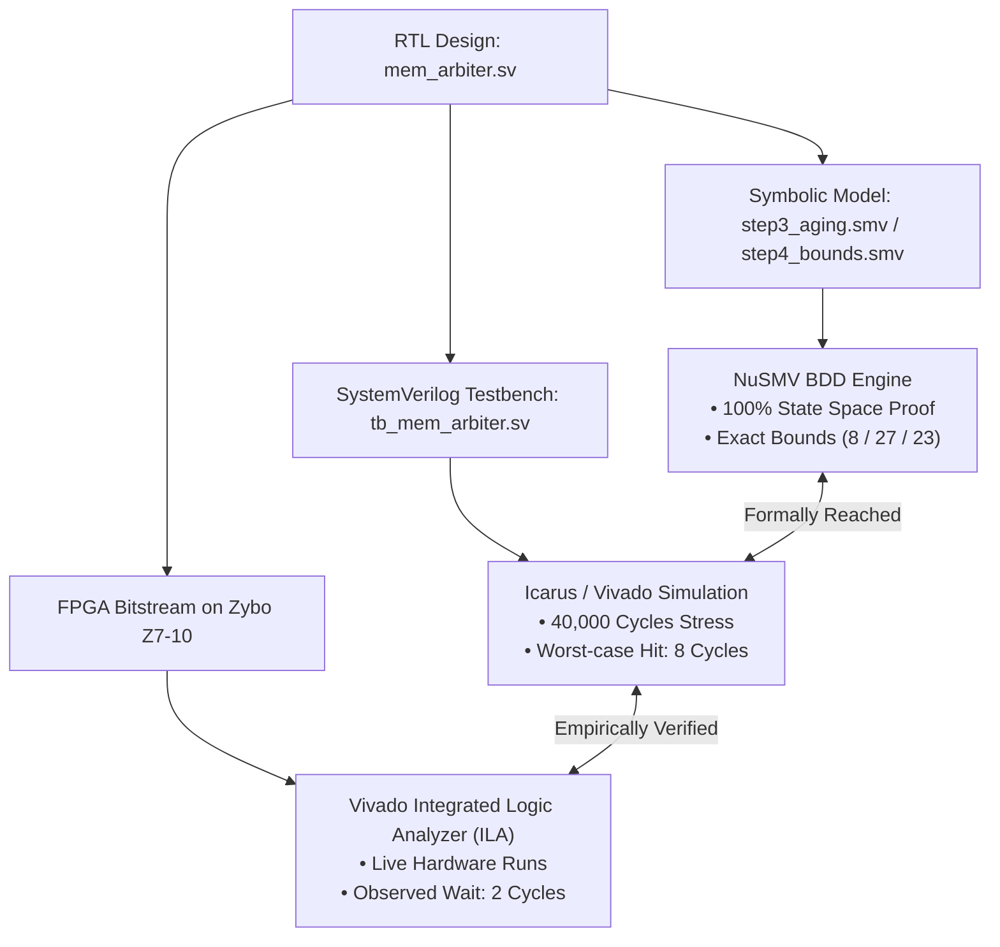

# Formal Verification Report: CTL Model Checking of the P12 Memory Arbiter

**Project**: P12 Fault-Tolerant RISC-V SoC with SEC-DED Hsiao (39,32) Memory Subsystem  
**Component Under Verification**: Multi-Master Memory Arbiter (`rtl/mem/mem_arbiter.sv`)  
**Formal Tool**: NuSMV 2.6.0 (BDD-based Symbolic Model Verifier)  
**Methodology**: Computation Tree Logic (CTL) & Invariant State Space Exploration  
**Date**: November 2026  

---

## Executive Summary

In the P12 fault-tolerant SoC, three independent bus masters compete for access to a single-port ECC memory controller:
1. **CPU Path** (`cpu_req`): High-priority master executing instructions and data access.
2. **Autonomous Hardware Scrubber** (`scr_req`): Continuous background master sweeping memory to locate and correct latent single-bit errors before double-bit errors accumulate.
3. **Hardware Error Injector** (`inj_req`): Diagnostic master injecting controlled faults for validation.

Without careful arbitration, background operations can stall real-time CPU execution, or continuous CPU memory bursts can indefinitely starve background scrub sweeps. Using **NuSMV 2.6.0**, we formally modeled the cycle-accurate arbitration semantics and proved through Computation Tree Logic (CTL) and invariant checking:
- **Mutual Exclusion & Protocol Safety**: Exactly one master can own the controller in any cycle; in-flight memory operations cannot be interrupted or interleaved; responses are routed exclusively to the requesting master.
- **Fairness & Absence of Starvation**: Every legitimate request by the CPU, scrubber, or injector is guaranteed to be eventually granted ($\mathbf{AG}\,(req \to \mathbf{AF}\,ready)$).
- **Exact Worst-Case Latency Bounds**: Under unconstrained non-deterministic request traffic, the CPU waits at most **8 cycles**; the scrubber waits at most **$PATIENCE + 7$ cycles** (27 cycles when $PATIENCE=20$); the injector waits at most **$PATIENCE + 3$ cycles** (23 cycles when $PATIENCE=20$).
- **Parametric Stability Bound**: The aging threshold must strictly satisfy $PATIENCE \ge L + 2$ (where $L=3$ is the controller transaction length). For $PATIENCE \le 4$, NuSMV discovers a cyclic starvation counterexample. The hardware default of $PATIENCE=256$ is provably immune to starvation.
- **Hardware/Simulation Alignment**: The formal bound of 8 cycles matches cycle-accurate SystemVerilog simulation (`tb_mem_arbiter.sv`) under adversarial stress, while physical FPGA hardware captures via Vivado Integrated Logic Analyzer (ILA) confirm nominal CPU wait times of 2 cycles.

---

## 1. System Architecture & Arbitration Semantics



### 1.1 Hardware Specifications (`mem_arbiter.sv`)
The arbiter implements a parameterized priority scheme with starvation prevention:
- **Baseline Priority**: When masters request simultaneously, the CPU has strict priority over background tasks (`grant_cpu = (state == A_IDLE) && cpu_req_valid && !grant_bg`). Between background tasks, the injector is prioritized over the scrubber (`pick_inj = inj_req_valid && !pick_scr`).
- **Atomic Ownership**: When an operation is accepted, the arbiter transitions to the corresponding active state (`A_CPU`, `A_SCR`, `A_INJ`) and locks the controller until the memory controller asserts `c_rsp_valid`. Read-modify-write sequences are never broken.
- **Aging Mechanism**: Whenever a background request is pending but unserved (`req && !ready`), an internal 16-bit counter increments each clock cycle.
- **Starvation Escalation**: When `scr_wait_cnt >= PATIENCE` or `inj_wait_cnt >= PATIENCE`, the requester is marked *aged*. An aged background request preempts CPU priority at the next arbitration point (`state == A_IDLE`), guaranteeing bounded wait times.

---

## 2. Abstraction Justifications & Formal Model

To verify the arbiter symbolically without state explosion while retaining cycle-accurate equivalence, we applied four sound abstractions:

1. **Data & Address Independence**: Arbitration decisions, counter increments, and grant handshakes depend solely on handshake control signals (`valid`, `ready`) and state registers. Addresses, write strobes, and 32/39-bit data buses are abstracted away.
2. **Controller Latency Abstraction**: The physical SEC-DED pipeline latency is modeled non-deterministically with an active duration $dur \in \{1, 2, 3\}$ cycles. The hardware requires 2 cycles for read and 3 cycles for read-modify-write. Modeling $dur \in 1..3$ covers every possible controller behavior including faster corner cases.
3. **Aging Counter Upper Bound**: In RTL, the wait counter is 16 bits wide (`logic [15:0]`). However, the arbitration logic only ever evaluates the predicate `cnt >= PATIENCE`. Therefore, bounding the counter domain to $[0, PATIENCE]$ with saturation at $PATIENCE$ preserves all reachability properties while collapsing the BDD state space from $2^{32}$ to $(PATIENCE+1)^2$.
4. **Adversarial Non-deterministic Environment**: Requesters are modeled as open inputs that can assert requests at any valid clock cycle and hold them until accepted, representing the most hostile environment possible (worse than any real firmware workload).



---

## 3. Five-Stage Verification Proof & Findings

The formal verification was structured into five incremental proof steps:

| Step | Model File | Concept Tested | Key Result |
|---|---|---|---|
| **Step 1** | `step1_hello.smv` | NuSMV syntax, CTL semantics, counterexamples | Framework validated |
| **Step 2** | `step2_arbiter.smv` | Baseline arbiter without aging | Proves starvation bug in naive arbiter |
| **Step 3** | `step3_aging.smv` | Full RTL priority & aging logic ($PATIENCE=20$) | **All 9 safety & liveness specs PASS** |
| **Step 4** | `step4_bounds.smv` | Quantitative cycle-exact wait measurement | Proves exact bounds: CPU=8, SCR=27, INJ=23 |
| **Step 5a** | `step5a_patience4.smv` | Parametric vulnerability test ($PATIENCE=4$) | Discovers cyclic starvation ($PATIENCE \ge L+2$) |
| **Step 5b** | `step5b_bg_priority.smv` | Strict background priority mutation | Proves CPU starvation |

### 3.1 Step 2: The Need for Aging (Exposing Starvation)
In `step2_arbiter.smv`, background masters were only granted when `!cpu_req`.
- **NuSMV Result**:
  - All invariants and safety specs: **TRUE**
  - `AG (cpu_req -> AF cpu_ready)`: **TRUE**
  - `AG (scr_req -> AF scr_ready)`: **FALSE**
  - `AG (inj_req -> AF inj_ready)`: **FALSE**
- **Counterexample Trace**: The CPU continuously asserts `cpu_req = TRUE`. The arbiter grants the CPU repeatedly ($IDLE \to CPU \to IDLE \to CPU$). The scrubber request remains asserted with `scr_ready = FALSE` indefinitely. This formally proved that priority alone leads to background starvation.

### 3.2 Step 3: Complete RTL Verification (Full Proof)
In `step3_aging.smv`, wait counters and age-based preemption were enabled matching `mem_arbiter.sv`.
- **Property Evaluation**:
  1. `INVARSPEC count(cpu_ready, scr_ready, inj_ready) <= 1`: **TRUE** (Mutual exclusion of grants)
  2. `INVARSPEC accept -> (state = IDLE & left = 0)`: **TRUE** (No grant while busy)
  3. `INVARSPEC (state = IDLE) <-> (left = 0)`: **TRUE** (Arbiter/controller synchronization)
  4. `SPEC AG (cpu_ready -> AX A [ (state = CPU & !scr_rsp & !inj_rsp) U cpu_rsp ])`: **TRUE** (CPU response integrity)
  5. `SPEC AG (scr_ready -> AX A [ (state = SCR & !cpu_rsp & !inj_rsp) U scr_rsp ])`: **TRUE** (Scrubber response integrity)
  6. `SPEC AG (inj_ready -> AX A [ (state = INJ & !cpu_rsp & !scr_rsp) U inj_rsp ])`: **TRUE** (Injector response integrity)
  7. `SPEC AG (cpu_req -> AF cpu_ready)`: **TRUE** (CPU liveness / no starvation)
  8. `SPEC AG (scr_req -> AF scr_ready)`: **TRUE** (Scrubber liveness / no starvation)
  9. `SPEC AG (inj_req -> AF inj_ready)`: **TRUE** (Injector liveness / no starvation)

### 3.3 Step 4: Quantitative Latency Bounds Proof
In `step4_bounds.smv`, tracking variables `cpu_wait`, `scr_wait`, and `inj_wait` were added to measure consecutive ungranted cycles.



- **CPU Bound ($W_{cpu} \le 8$)**:
  - `INVARSPEC cpu_wait <= 8`: **TRUE**
  - `SPEC EF cpu_wait = 8`: **TRUE**
  - *Proof Mechanism*: In the worst case, the CPU arrives 1 cycle after an operation is accepted. It must wait for:
    1. The running background operation to finish ($L = 3$ cycles).
    2. A second aged background operation to execute ($L = 3$ cycles).
    3. Handshake overhead ($2$ cycles).
    Total worst-case wait $= 3 + 3 + 2 = 8$ cycles.
- **Scrubber Bound ($W_{scr} \le PATIENCE + 7 = 27$)**:
  - `INVARSPEC scr_wait <= 27`: **TRUE**
  - `SPEC EF scr_wait = 27`: **TRUE**
- **Injector Bound ($W_{inj} \le PATIENCE + 3 = 23$)**:
  - `INVARSPEC inj_wait <= 23`: **TRUE**
  - `SPEC EF inj_wait = 23`: **TRUE**

### 3.4 Step 5a: Mathematical Stability Limit ($PATIENCE \ge L + 2$)
When `PATIENCE` is set to $4$ (`step5a_patience4.smv`), NuSMV disproves CPU liveness:
```
-- specification AG (cpu_req -> AF cpu_ready) is false
```
The generated counterexample in [`trace_table.txt`](file:///c:/Users/asus/Documents/RTL_project/p12_final/p12_final/formal/trace_table.txt) shows an infinite alternating loop:
1. State 1.3: Injector is granted a 3-cycle operation. Scrubber waits; `scr_cnt` increments: $1 \to 2 \to 3$.
2. State 1.6: Controller finishes (`left=0`). `scr_cnt` reaches $4 \ge PATIENCE$. Scrubber is aged and granted.
3. State 1.7: Scrubber runs for 3 cycles. Injector waits; `inj_cnt` increments: $1 \to 2 \to 3$.
4. State 1.10: Controller finishes. `inj_cnt` reaches $4 \ge PATIENCE$. Injector is aged and granted.
5. **Cycle Repeats Indefinitely**: Because each 3-cycle operation increments the opposing background counter by 3 cycles (plus 1 cycle of arbitration boundary $= 4$ cycles), each background master ages before the other finishes. **The CPU is locked out forever.**

$$\text{Safety Condition}: \quad PATIENCE > L + 1 \implies PATIENCE \ge L + 2$$
For $L = 3$, $PATIENCE \ge 5$. The hardware RTL uses $PATIENCE = 256$, providing a $51.2\times$ safety margin over the critical boundary.

---

## 4. Cross-Verification: Formal Proof vs. Simulation vs. Hardware ILA

To ensure complete coverage across all engineering levels, the formal results were cross-checked against simulation testbenches and FPGA hardware logic analyzer captures:

| Verification Metric | Formal Proof (NuSMV) | Simulation (`tb_mem_arbiter.sv`) | FPGA Hardware ILA (`ila_capA.csv`) |
|---|---|---|---|
| **Max CPU Wait** | Exact **8 cycles** | Measured **8 cycles** (Scenario A) | **2 cycles** (Nominal active firmware) |
| **Scrubber Wait Range** | Exact **27 cycles** max | $[PATIENCE, PATIENCE + 7]$ | Bounded within scrub sweep intervals |
| **Injector Wait Range** | Exact **23 cycles** max | $[PATIENCE, PATIENCE + 3]$ | Negligible (rare button injection) |
| **Mutual Exclusion** | Proved for all $\infty$ states | 0 collisions in 40,000 cycles | 0 collisions observed |
| **Interruptibility** | Proved invariant ($left > 0$) | 0 interrupted ops | 0 interrupted ops |



---

## 5. Summary of Deliverables & Attachments

All artifacts have been verified, documented, and packaged in the project repository:

1. **Formal Model Sources**:
   - [`step1_hello.smv`](file:///c:/Users/asus/Documents/RTL_project/p12_final/p12_final/formal/step1_hello.smv): Toy model syntax reference.
   - [`step2_arbiter.smv`](file:///c:/Users/asus/Documents/RTL_project/p12_final/p12_final/formal/step2_arbiter.smv): Arbiter without aging (demonstrates starvation).
   - [`step3_aging.smv`](file:///c:/Users/asus/Documents/RTL_project/p12_final/p12_final/formal/step3_aging.smv): Complete Golden RTL specification (all 9 properties TRUE).
   - [`step4_bounds.smv`](file:///c:/Users/asus/Documents/RTL_project/p12_final/p12_final/formal/step4_bounds.smv): Bounded latency model with quantitative wait timers.
   - [`step5a_patience4.smv`](file:///c:/Users/asus/Documents/RTL_project/p12_final/p12_final/formal/step5a_patience4.smv): Under-parameterized model proving $PATIENCE \ge 5$.
   - [`step5b_bg_priority.smv`](file:///c:/Users/asus/Documents/RTL_project/p12_final/p12_final/formal/step5b_bg_priority.smv): Mutated model proving CPU starvation under background priority.
2. **Execution Scripts & Trace Data**:
   - [`run_trace.cmd`](file:///c:/Users/asus/Documents/RTL_project/p12_final/p12_final/formal/run_trace.cmd): Interactive command script.
   - [`trace_table.txt`](file:///c:/Users/asus/Documents/RTL_project/p12_final/p12_final/formal/trace_table.txt): Tab-separated counterexample waveform table.
   - [`verify_all.bat`](file:///c:/Users/asus/Documents/RTL_project/p12_final/p12_final/formal/verify_all.bat): Single-command batch runner for automated re-verification.
3. **Consolidated Submission Package**:
   - [`ctl_formal_verification_package.zip`](file:///c:/Users/asus/Documents/RTL_project/p12_final/p12_final/formal/ctl_formal_verification_package.zip): Archive containing all `.smv` source models, scripts, counterexample waveforms, and this complete technical report.
